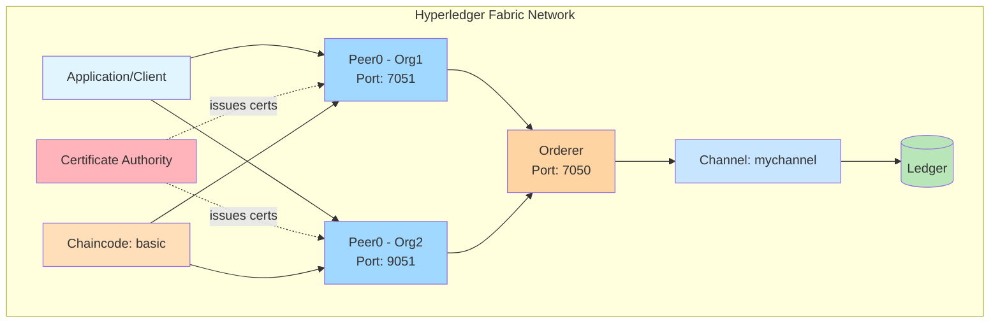
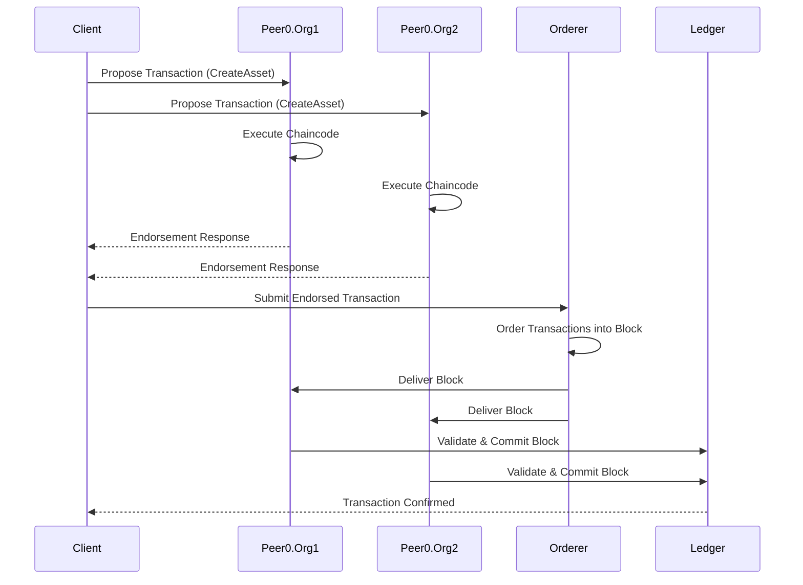

# 🔗 Experiment 10: Hyperledger Fabric Network

<div align="center">


### *Implementing a permissioned enterprise blockchain with Hyperledger Fabric, deploying chaincode, and performing secure asset management operations*

</div>

---

## 📋 Experiment Information

| **Field** | **Details** |
|-----------|-------------|
| **Name** | Atharva Lotankar |
| **Class** | D20C |
| **Roll No.** | 20 |
| **Date** | 21 / 10 / 2026 |
| **Experiment No.** | 10 |

---

## 🎯 Aim

To implement a **Hyperledger Fabric network**, deploy **chaincode** (smart contracts), and perform **asset creation**, **querying**, and **transfer operations** in a permissioned blockchain environment.

---

## 🛠️ Prerequisites

Before starting this experiment, ensure the following tools are installed:

### System Requirements
- **Windows Subsystem for Linux (WSL / Ubuntu)** - Linux environment on Windows
- **Docker & Docker Compose** - Container orchestration
- **Git** - Version control
- **Node.js & npm** - JavaScript runtime and package manager
- **jq** - JSON processor for command line
- **curl** - Data transfer utility

### Installation Verification Commands
```bash
# Check Docker
docker --version

# Check Docker Compose
docker-compose --version

# Check Node.js
node --version

# Check npm
npm --version

# Check Git
git --version

# Check jq
jq --version

# Check curl
curl --version
```

---

## 📚 Theory

### 1. Hyperledger Fabric Architecture

Unlike **permissionless blockchains** (like Ethereum or Bitcoin) that rely on public Proof-of-Work, **Hyperledger Fabric** is a **private, permissioned enterprise blockchain framework**. 

#### Key Architectural Components:

| Component | Description |
|-----------|-------------|
| **Peers** | Nodes that maintain the ledger state and run smart contracts (chaincode). They validate and commit transactions. |
| **Orderers** | Nodes that form the ordering service to package validated transactions into blocks and ensure network consensus. |
| **Channels** | Private communication sub-networks allowing specific organizations to conduct confidential transactions. |
| **Certificate Authority (CA)** | Issues identity certificates to network participants, establishing permissioned access control. |
| **Ledger** | Combines the world state (current data) with the blockchain (transaction history). |
| **Membership Service Provider (MSP)** | Provides identity validation and authentication for network participants. |

#### Architecture Diagram Flow:
```
Application → SDK → Peer Nodes → Orderer → Channel → Ledger
                ↓
         Certificate Authority (CA)
```

### 2. Chaincode (Smart Contracts)

In Fabric, smart contracts are termed **Chaincode**. Written in languages such as **JavaScript**, **Go**, or **Java**, chaincode defines:
- Asset data structures
- Business transaction rules
- Access control logic

#### Common Chaincode Functions:
- `InitLedger` - Initialize the ledger with default assets
- `CreateAsset` - Add new assets to the blockchain
- `ReadAsset` - Query specific assets by ID
- `UpdateAsset` - Modify existing asset properties
- `DeleteAsset` - Remove assets from the ledger
- `TransferAsset` - Change ownership of assets
- `GetAllAssets` - Retrieve all assets from the state database

### 3. Differences: Hyperledger Fabric vs Ethereum

| Feature | Hyperledger Fabric | Ethereum |
|---------|-------------------|----------|
| **Type** | Permissioned | Permissionless |
| **Consensus** | Pluggable (Kafka, Raft) | PoW / PoS |
| **Smart Contracts** | Chaincode (Go, JS, Java) | Solidity |
| **Transaction Speed** | High (1000+ TPS) | Lower (~15-30 TPS) |
| **Privacy** | Channel-based privacy | Public by default |
| **Use Case** | Enterprise solutions | Public dApps |

---

## 🧪 Procedure

### Step 1: Update System Packages

**Command:**
```bash
sudo apt update && sudo apt upgrade -y
```

**Explanation:**  
Updates the package index and upgrades installed packages to ensure system security patches and compatible libraries are up to date.

---

### Step 2: Install Dependencies & Verify Tools

**Commands:**
```bash
# Install system utilities
sudo apt install -y jq curl git nodejs npm docker.io docker-compose-v2

# Start Docker service
sudo service docker start

# Grant Docker permissions
sudo usermod -aG docker $USER

# Verify installations
docker --version
docker-compose --version
node --version
npm --version
git --version
```

**Terminal Verification:**
- ✅ `docker-compose-v2` installed successfully
- ✅ Node.js (v22.22.1)
- ✅ npm (9.2.0)
- ✅ Git (2.53.0)
- ✅ Docker (29.1.3)

---

### Step 3: Clone Fabric Samples Repository

**Commands:**
```bash
cd ~
git clone https://github.com/hyperledger/fabric-samples.git
cd fabric-samples
```

**Terminal Verification:**
- ✅ Repository cloned successfully
- ✅ Directory accessed: `~/fabric-samples`

---

### Step 4: Install Fabric Binaries and Docker Images

**Commands:**
```bash
curl -sSLO https://raw.githubusercontent.com/hyperledger/fabric/main/scripts/install-fabric.sh
chmod +x install-fabric.sh
./install-fabric.sh binary docker
```

**Terminal Verification:**
- ✅ Downloaded Fabric binaries (v2.5.16)
- ✅ Downloaded fabric-ca-client (v1.5.17)
- ✅ Installed to `/home/atharva-lotankar/fabric-samples`

---

### Step 5: Verify Fabric Docker Images

**Command:**
```bash
docker images | grep hyperledger
```

**Terminal Verification:**
- ✅ `fabric-peer:2.5.16`
- ✅ `fabric-orderer:2.5.16`
- ✅ `fabric-ccenv:2.5.16`
- ✅ `fabric-baseos:2.5.16`
- ✅ `fabric-ca:1.5.17`

---

### Step 6: Set Binary Environment Variables

**Commands:**
```bash
export PATH=$PATH:~/fabric-samples/bin
export FABRIC_CFG_PATH=~/fabric-samples/config
peer version
```

**Terminal Verification:**
- ✅ CLI tool output: `Version: v2.5.16`

---

### Step 7: Launch Test Network and Create Channel

**Commands:**
```bash
cd ~/fabric-samples/test-network
./network.sh up createChannel
```

**Terminal Verification:**
- ✅ Container `peer0.org1.example.com` started (port 7051)
- ✅ Container `peer0.org2.example.com` started (port 9051)
- ✅ Container `orderer.example.com` started (port 7050)
- ✅ Channel genesis block `mychannel.block` generated

---

### Step 8: Deploy Smart Contract (Chaincode)

**Command:**
```bash
./network.sh deployCC -ccn basic -ccp ../asset-transfer-basic/chaincode-javascript -ccl javascript
```

**Terminal Verification:**
- ✅ Chaincode packaged: `basic.tar.gz`
- ✅ Successfully installed on `peer0.org1` (status code 200)
- ✅ Chaincode committed to channel `mychannel`

---

### Step 9: Configure Peer Environment Variables (Org1 Admin)

**Commands:**
```bash
export CORE_PEER_TLS_ENABLED=true
export CORE_PEER_LOCALMSPID="Org1MSP"
export CORE_PEER_TLS_ROOTCERT_FILE=${PWD}/organizations/peerOrganizations/org1.example.com/peers/peer0.org1.example.com/tls/ca.crt
export CORE_PEER_MSPCONFIGPATH=${PWD}/organizations/peerOrganizations/org1.example.com/users/Admin@org1.example.com/msp
export CORE_PEER_ADDRESS=localhost:7051
```

**Terminal Verification:**
- ✅ Active peer context: `localhost:7051` with TLS enabled

---

### Step 10: Initialize Ledger Assets

**Command:**
```bash
peer chaincode invoke -o localhost:7050 --ordererTLSHostnameOverride orderer.example.com --tls --cafile "${PWD}/organizations/ordererOrganizations/example.com/orderers/orderer.example.com/msp/tlscacerts/tlsca.example.com-cert.pem" -C mychannel -n basic --peerAddresses localhost:7051 --tlsRootCertFiles "${PWD}/organizations/peerOrganizations/org1.example.com/peers/peer0.org1.example.com/tls/ca.crt" --peerAddresses localhost:9051 --tlsRootCertFiles "${PWD}/organizations/peerOrganizations/org2.example.com/peers/peer0.org2.example.com/tls/ca.crt" -c '{"function":"InitLedger","Args":[]}'
```

**Terminal Verification:**
- ✅ Transaction committed with status `(VALID)`
- ✅ Endorsed at `localhost:7051` (status: 200)
- ✅ Endorsed at `localhost:9051` (status: 200)

---

### Step 11: Query All Assets

**Command:**
```bash
peer chaincode query -C mychannel -n basic -c '{"Args":["GetAllAssets"]}'
```

**Output:**
```json
[
  {"ID":"asset1","Color":"blue","Size":5,"Owner":"Tomoko","AppraisedValue":300},
  {"ID":"asset2","Color":"red","Size":5,"Owner":"Brad","AppraisedValue":400},
  {"ID":"asset3","Color":"green","Size":10,"Owner":"Jin Soo","AppraisedValue":500},
  {"ID":"asset4","Color":"yellow","Size":10,"Owner":"Max","AppraisedValue":600},
  {"ID":"asset5","Color":"black","Size":15,"Owner":"Adriana","AppraisedValue":700},
  {"ID":"asset6","Color":"white","Size":15,"Owner":"Michel","AppraisedValue":800}
]
```

**Terminal Verification:**
- ✅ Returned JSON array containing default assets (asset1 to asset6)

---

### Step 11b: Query Specific Asset (asset5)

**Command:**
```bash
peer chaincode query -C mychannel -n basic -c '{"Args":["ReadAsset","asset5"]}'
```

**Output:**
```json
{"AppraisedValue":700,"Color":"black","ID":"asset5","Owner":"Adriana","Size":15,"docType":"asset"}
```

**Terminal Verification:**
- ✅ Successfully retrieved asset5 details

---

### Step 11c: Create New Asset (asset10)

**Command:**
```bash
peer chaincode invoke -o localhost:7050 --ordererTLSHostnameOverride orderer.example.com --tls --cafile "${PWD}/organizations/ordererOrganizations/example.com/orderers/orderer.example.com/msp/tlscacerts/tlsca.example.com-cert.pem" -C mychannel -n basic --peerAddresses localhost:7051 --tlsRootCertFiles "${PWD}/organizations/peerOrganizations/org1.example.com/peers/peer0.org1.example.com/tls/ca.crt" --peerAddresses localhost:9051 --tlsRootCertFiles "${PWD}/organizations/peerOrganizations/org2.example.com/peers/peer0.org2.example.com/tls/ca.crt" -c '{"function":"CreateAsset","Args":["asset10","blue","10","Atharva","1000"]}'
```

**Output:**
```
Chaincode invoke successful. result: status:200 
payload:{"ID":"asset10","Color":"blue","Size":10,"Owner":"Atharva","AppraisedValue":1000}
```

**Terminal Verification:**
- ✅ Asset10 created with owner **Atharva**

---

### Step 12: Transfer Asset Ownership

**Command:**
```bash
peer chaincode invoke -o localhost:7050 --ordererTLSHostnameOverride orderer.example.com --tls --cafile "${PWD}/organizations/ordererOrganizations/example.com/orderers/orderer.example.com/msp/tlscacerts/tlsca.example.com-cert.pem" -C mychannel -n basic --peerAddresses localhost:7051 --tlsRootCertFiles "${PWD}/organizations/peerOrganizations/org1.example.com/peers/peer0.org1.example.com/tls/ca.crt" --peerAddresses localhost:9051 --tlsRootCertFiles "${PWD}/organizations/peerOrganizations/org2.example.com/peers/peer0.org2.example.com/tls/ca.crt" -c '{"function":"TransferAsset","Args":["asset10","Rahul"]}'
```

**Output:**
```
Chaincode invoke successful. result: status:200 payload:"Atharva"
```

**Terminal Verification:**
- ✅ Asset10 ownership transferred from **Atharva** to **Rahul**
- ✅ Previous owner returned: "Atharva"

---

### Step 13: Teardown Network

**Command:**
```bash
./network.sh down
```

**Terminal Verification:**
- ✅ Containers `peer0.org1`, `peer0.org2`, `orderer.example.com` removed
- ✅ Docker Compose volumes removed
- ✅ Generated images cleaned

---

## ✅ Result

The **Hyperledger Fabric network** was successfully implemented. **Chaincode** was deployed and **asset operations** such as:
- ✅ **Creation** (asset10)
- ✅ **Querying** (GetAllAssets, ReadAsset)
- ✅ **Transfer** (Atharva → Rahul)

were performed successfully. The asset was created with owner name **Atharva**, confirming correct execution.

---

## 🎓 Conclusion

This experiment demonstrated how **permissioned blockchain networks** work using **Hyperledger Fabric** and how transactions are securely executed through:
- **Certificate-based authentication**
- **Channel-based privacy**
- **Endorsement policies**
- **Chaincode execution**

The experiment helped in understanding **real-time asset management** using **smart contracts (chaincode)** in an **enterprise blockchain environment**.

### Key Learnings:
1. ✅ Understanding of Hyperledger Fabric architecture (Peers, Orderers, Channels, CA)
2. ✅ Deployment and lifecycle management of chaincode
3. ✅ Asset creation, querying, and transfer operations
4. ✅ Permissioned blockchain vs permissionless blockchain differences
5. ✅ Enterprise-grade blockchain implementation
6. ✅ Docker-based blockchain network orchestration

---

## 📊 Network Architecture Diagram



---

## 🔍 Chaincode Transaction Flow



---

## 📁 Files Included

- **Blockchain_Lab_10 - Atharva Lotankar(D20C_20).pdf** - Complete experiment documentation with screenshots
- **README.md** - This detailed experiment guide

---

## 🚀 Quick Reference Commands

### Network Management
```bash
# Start network with channel
./network.sh up createChannel

# Deploy chaincode
./network.sh deployCC -ccn basic -ccp ../asset-transfer-basic/chaincode-javascript -ccl javascript

# Stop network
./network.sh down
```

### Asset Operations
```bash
# Initialize ledger
peer chaincode invoke -o localhost:7050 ... -c '{"function":"InitLedger","Args":[]}'

# Get all assets
peer chaincode query -C mychannel -n basic -c '{"Args":["GetAllAssets"]}'

# Read specific asset
peer chaincode query -C mychannel -n basic -c '{"Args":["ReadAsset","asset5"]}'

# Create asset
peer chaincode invoke ... -c '{"function":"CreateAsset","Args":["assetID","color","size","owner","value"]}'

# Transfer asset
peer chaincode invoke ... -c '{"function":"TransferAsset","Args":["assetID","newOwner"]}'
```

---

## 🔗 Additional Resources

- [Hyperledger Fabric Documentation](https://hyperledger-fabric.readthedocs.io/)
- [Fabric Samples Repository](https://github.com/hyperledger/fabric-samples)
- [Chaincode for Developers](https://hyperledger-fabric.readthedocs.io/en/latest/chaincode4ade.html)
- [Hyperledger Foundation](https://www.hyperledger.org/)

---

<div align="center">

**Made with ⛓️ for Enterprise Blockchain Learning**

[← Back to Main Repository](../)

</div>
